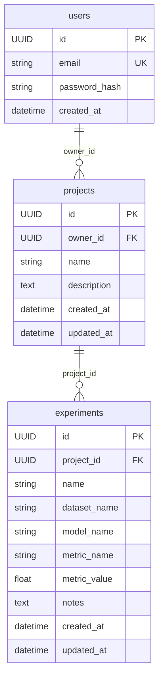

# Modelo de datos

UUID generados en la aplicación; timestamps conscientes de UTC. SQLite almacena
las fechas sin zona y el tipo SQLAlchemy restituye UTC al leerlas. El correo se
normaliza con trim y minúsculas; la base impone unicidad y claves foráneas.
SQLite activa `PRAGMA foreign_keys=ON` en todas las conexiones de la aplicación.

No hay borrados en cascada. La API de F2 debe convertir el rechazo de un proyecto
con experimentos en HTTP 409. La métrica admite valores fuera del intervalo 0..1.
El modelo no incluye `status`. La migración 0001 usa tipos portables; PostgreSQL
se verificará con su motor real durante F3.

Aplicar con `alembic upgrade head`; comprobar con `alembic current` y
`alembic check`. Las pruebas construyen su esquema ejecutando la migración
en una base temporal, no con `create_all`. El arranque de la API no modifica
el esquema de la base: las migraciones se ejecutan explícitamente.
